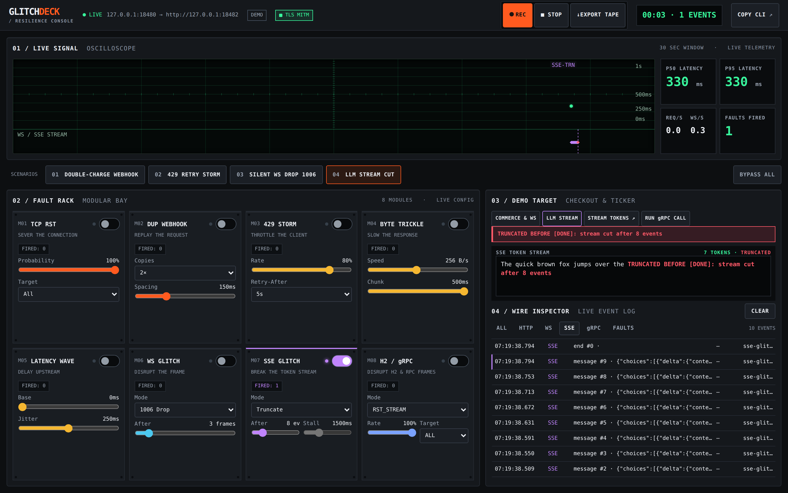

# Glitchdeck

Glitchdeck is a local fault proxy with a live wire inspector and replayable YAML tapes. It handles HTTP/1.1, WebSocket, SSE, prior-knowledge h2c, TLS HTTP/2 and gRPC. Optional TLS interception uses a Glitchdeck CA you explicitly trust in the client.



## Install

On macOS or Linux:

```sh
curl -fsSL https://raw.githubusercontent.com/hardw00t/glitchdeck/main/install.sh | sh
# Pin a release:
curl -fsSL https://raw.githubusercontent.com/hardw00t/glitchdeck/main/install.sh | GLITCHDECK_VERSION=v2.0.0 sh
```

On Windows, download and extract the matching `.zip` from [Releases](https://github.com/hardw00t/glitchdeck/releases).

With Go 1.26 or newer:

```sh
go install github.com/hardw00t/glitchdeck/cmd/glitchdeck@latest
```

## 15-second quickstart

Start the console:

```sh
glitchdeck demo
```

Open the [console](http://127.0.0.1:8081). Select **Double-Charge Webhook** and run a checkout, or select **LLM Stream Cut** and click **Stream Tokens**. To see a gRPC fault, arm **H2 / gRPC** and click **Run gRPC Call**. **REC → STOP → EXPORT TAPE** captures a replay of the traffic and rules. Review the tape before sharing it: authorization and cookie headers are removed, but request bodies and URLs can contain sensitive data.

In another terminal, from the repository root, replay a stream cut around a real client command (requires curl):

```sh
glitchdeck exec --tape examples/tapes/openai-sse-eof-before-done.tape.yaml --json -- sh -c '
  curl -q -fsSN -H "Content-Type: application/json" \
    -d "{\"tokens\":8,\"token_ms\":1}" "$GLITCHDECK_PROXY_URL/api/chat/stream"
'
```

The report shows the fault and a passing stream assertion. `exec` starts its own demo upstream, so this command also works without the console.

To proxy your own service:

```sh
glitchdeck proxy --target http://127.0.0.1:3000
```

The proxy and console default to `127.0.0.1:8080` and `127.0.0.1:8081`. Use `--listen` and `--ui` to choose other addresses. An explicit `--target` grants only its exact reverse-proxy origin. CONNECT, absolute-form requests, and tape replay need `--upstream-allow` (or `upstream_allow` in a tape) for non-loopback upstreams. Do not expose a TLS-intercepting listener to untrusted clients.

`glitchdeck demo` enables TLS interception by default. `glitchdeck ca init` creates a persistent CA; `glitchdeck ca print` prints only its public certificate. Use `--ca-dir` to select a store and `--upstream-ca` to trust a private upstream CA. Trust the interception CA only in the client under test. Prior-knowledge h2c is supported; the HTTP/1.1 `Upgrade: h2c` handshake is not. `--h2-tap=off` disables frame injection while retaining HTTP/2 relay.

Before passing `--ca-dir` to `glitchdeck demo`, initialize that directory with `glitchdeck ca init --ca-dir <dir>`. Without `--ca-dir`, the demo uses a temporary CA.

## Replay a tape

```sh
glitchdeck test --json examples/clean.tape.yaml
glitchdeck test examples/checkout-dup-webhook.tape.yaml
```

The checkout regression tape exits `1` and reports `duplicate_charges: expected 0, got 1`. [Example packs](examples/tapes/) show faults against the bundled demo and an OpenAI-compatible upstream. Version 1 tapes keep the original `test --json` array. Version 2 tapes and `exec --json` emit a versioned object with assertions and applied faults. `--report` saves that object to a file.

`exec` injects `GLITCHDECK_PROXY_URL`, `HTTP_PROXY`, `HTTPS_PROXY`, `NO_PROXY`, and lowercase variants. The `NO_PROXY` list includes the proxy's own host and port. Point a client's base URL at `GLITCHDECK_PROXY_URL` to use reverse mode, including with Go clients that bypass environment proxies for loopback. `exec` sets `NODE_USE_ENV_PROXY=1` and, when TLS is enabled, provides temporary CA paths to supported clients. Proxy authentication is opt-in with `--proxy-auth`. macOS process cleanup covers the process group; detached descendants can escape. Windows cleanup is best-effort and does not guarantee stopping grandchildren.

| Exit | Meaning |
| --- | --- |
| `0` | Expectations passed |
| `1` | Assertion, fault count, or child exit differed from expectations |
| `2` | Usage or invalid tape; also runtime failure for `test` |
| `3` | `exec` proxy, CA, or cleanup failure |
| `124` | Child timed out |
| `125` | Child could not start |
| `126` | Child command is not executable |
| `127` | Child command was not found |

## Your own app

With an OpenAI-compatible SSE server running on port 3000, wrap the client from the repository root:

```sh
glitchdeck exec --tape examples/tapes/your-app-openai-sse-cut.tape.yaml --target http://127.0.0.1:3000 --json -- sh -c '
  export OPENAI_BASE_URL="$GLITCHDECK_PROXY_URL/v1"
  curl -q -fsSN --max-time 5 -H "Content-Type: application/json" -d '\''{"model":"local","messages":[{"role":"user","content":"Hi"}],"stream":true}'\'' "$OPENAI_BASE_URL/chat/completions"'
```

Replace the curl line with your app's launch command if its SDK reads `OPENAI_BASE_URL`; otherwise, pass that URL as the SDK's base URL. Use a model your server supports. The tape closes the stream just before `[DONE]`. Curl exits `0` on this clean HTTP close, and the JSON report lists one `openai-stream-cut` fault for one streaming request. For a direct reverse proxy to an HTTPS origin such as `https://api.openai.com`, set `--target` to that origin (no `/v1` suffix). This exact reverse-proxy origin needs neither `--upstream-allow` nor `--tls`; forwarding HTTPS through CONNECT instead requires the explicit allowlist and `--tls` to inspect the stream.

## Faults

| Fault | Behavior |
| --- | --- |
| `tcp-rst` | Reset the TCP connection before headers or after a byte budget |
| `dup-webhook` | Replay a request after a configured delay |
| `rate-limit` | Return an HTTP status and `Retry-After` without calling upstream |
| `byte-trickle` | Pace response chunks and optionally stall once |
| `latency-wave` | Add seeded sine, spike, or jitter delay |
| `ws-glitch` | Drop, delay, corrupt, truncate, or abnormally close frames |
| `sse-glitch` | Stall, drop events, truncate, corrupt JSON, or close before a terminator |
| `h2-glitch` | Send RST_STREAM or GOAWAY with a selected error code |
| `grpc-glitch` | Return an injected gRPC status before or after response messages |

## MCP and CI

Add `glitchdeck mcp` to a client that supports stdio MCP:

```json
{"mcpServers":{"glitchdeck":{"command":"glitchdeck","args":["mcp"]}}}
```

Use `proxy_start` with a loopback target or `demo`, `fault_set` to arm rules, and `wire_events` to inspect traffic. Then export a tape or call `tape_run` to replay one. See [SKILL.md](SKILL.md) for the regression workflow.

To run the [composite action](action.yml) from a checkout of this repository:

```yaml
- uses: actions/checkout@v4
- uses: ./
  with:
    tape: examples/clean.tape.yaml
    version: local
```

For a published action ref, omit `version` to use that ref. The action uses verified release binaries when available for the requested release, with a Go build for source refs. It exposes `exit-code` and the JSON `report` path.

## Console screenshots

- [Desktop: v2 default](docs/screenshots/v2-desktop-1440-default.png)
- [Desktop: LLM stream cut](docs/screenshots/v2-desktop-1440-llm-stream-cut.png)
- [Desktop: H2/gRPC fault](docs/screenshots/v2-desktop-1440-h2-grpc-fault.png)
- [Mobile: fault rack](docs/screenshots/v2-mobile-390-rack.png)
- [Mobile: LLM demo](docs/screenshots/v2-mobile-390-demo-llm.png)
- [v0 desktop](docs/screenshots/desktop-1440-idle.png) · [v0 mobile](docs/screenshots/mobile-390-rack.png)
